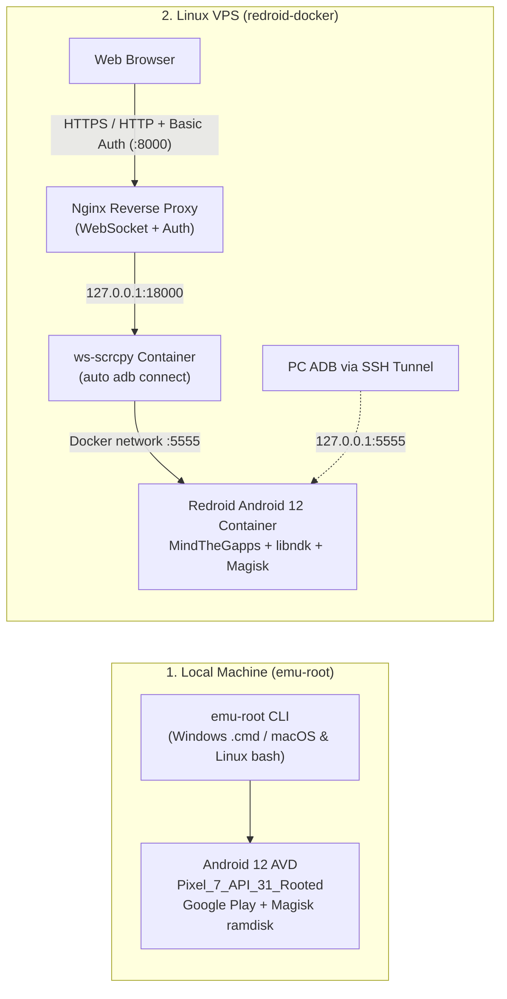

<div align="center">

# 🤖 Rooted Android 12 — Local `emu-root` & Cloud `Redroid + ws-scrcpy`

**Two production-tested ways to run a rooted Android 12 (API 31) environment with Google Play Store & Magisk — locally on Windows / macOS / Ubuntu, or headlessly on any Linux VPS via Docker + browser UI.**

[](https://github.com/heryandp/rooted-android-x86-docker/actions/workflows/ci.yml)
[](LICENSE)

<!-- Stack Badges -->
[-3DDC84?style=for-the-badge&logo=android&logoColor=white)](#)
[](#)
[](#)
[](#)
[](#)
[](#)
[](#)

<!-- Platform Badges -->
[](emu-root/installers/windows/install-windows.ps1)
[-000000?style=flat-square&logo=apple&logoColor=white)](emu-root/installers/macos/install-macos.sh)
[-000000?style=flat-square&logo=apple&logoColor=white)](emu-root/installers/macos/install-macos.sh)
[](emu-root/installers/ubuntu/install-ubuntu.sh)
[](emu-root/installers/ubuntu/build-deb.sh)

</div>

---

## 🧭 Choose Your Setup

| Feature | 1. Local Emulator (`emu-root/`) | 2. Cloud VPS Docker (`redroid-docker/`) |
|---|---|---|
| **Best For** | Daily local dev/testing on PC/Mac with GPU acceleration | 24/7 cloud Android on a standard VPS (accessible from browser) |
| **Android Stack** | Android 12 (API 31) Official Google Play AVD + **Magisk** (`rootAVD`) | **Redroid** Android 12 (`64only`) + **MindTheGapps** + **`libndk` ARM64** + **Magisk** |
| **Virtualization** | Requires WHPX/HAXM (Windows), HVF (macOS), or `/dev/kvm` (Linux) | **No `/dev/kvm` required** — only Linux `binder_linux` (`binderfs` + `memfd`) |
| **Supported OS** | Windows, macOS (Intel `x86_64` & Apple Silicon `arm64`), Ubuntu/Debian (`.sh` & `.deb`) | Ubuntu 22.04 / 24.04 LTS & Debian 12 VPS (`x86_64`) |
| **Display / Access** | Native Desktop Window (`gpu=host`) + `adb -e` | Browser Web UI (**`ws-scrcpy`**) via SSH Tunnel or **Nginx Basic Auth** |
| **Memory Footprint** | ~4 GB RAM (configurable) | ~1.5–1.8 GB RAM (capped at `2.5 GB` via Docker Compose) |

---

## 🏗️ Architecture Overview



---

## 📦 Repository Structure

```text
rooted-android-x86-docker/
├── emu-root/                                  # Setup 1: Local Rooted Android 12 AVD
│   ├── bin/
│   │   ├── emu-root.cmd                       # Windows launcher (safe PATH, -e flag, timeout)
│   │   └── emu-root                           # macOS (Intel & Silicon) + Linux launcher
│   ├── installers/
│   │   ├── windows/install-windows.ps1        # Windows automated PowerShell installer
│   │   ├── macos/install-macos.sh             # macOS Intel (x86_64) & Apple Silicon (arm64)
│   │   └── ubuntu/
│   │       ├── install-ubuntu.sh              # Ubuntu/Debian .sh installer
│   │       └── build-deb.sh                   # Builds emu-root_<version>_all.deb
│   ├── packaging/deb/                         # Debian package control & postinst scripts
│   └── README.md
└── redroid-docker/                            # Setup 2: VPS Redroid + ws-scrcpy + Docker
    ├── docker-compose.yml                     # Redroid + ws-scrcpy stack (localhost-bound)
    ├── .env.example                           # Resolution, FPS, RAM limits, bindings
    ├── install-vps.sh                         # One-command Ubuntu/Debian VPS installer
    ├── nginx/redroid-scrcpy.conf.template     # Nginx Basic Auth + WebSocket reverse proxy
    ├── scripts/
    │   ├── setup-nginx-auth.sh                # Safely expose port 8000 with HTTP Basic Auth
    │   └── manage.sh                          # start / stop / status / stats / logs / gsf-id
    └── README.md
```

---

## 🚀 Installation 1: `emu-root` (Windows · macOS · Ubuntu)

Creates **`Pixel_7_API_31_Rooted`** (Android 12 Play Store, 4 vCPU, 4 GB RAM, 8 GB data, Cold Boot), patches `ramdisk.img` with Magisk via [`rootAVD`](https://gitlab.com/newbit/rootAVD), and installs the global `emu-root` command.

### 🪟 Windows (PowerShell)
```powershell
git clone https://github.com/heryandp/rooted-android-x86-docker.git
cd rooted-android-x86-docker\emu-root\installers\windows
powershell -ExecutionPolicy Bypass -File .\install-windows.ps1
```
> Installs `emu-root.cmd` into `%USERPROFILE%\bin` (safe from Android SDK emulator updates) and adds it to your User `PATH`.

### 🍎 macOS (Intel `x86_64` & Apple Silicon `arm64`)
```bash
git clone https://github.com/heryandp/rooted-android-x86-docker.git
cd rooted-android-x86-docker/emu-root/installers/macos
chmod +x install-macos.sh
./install-macos.sh
```
> Automatically detects your Mac CPU via `uname -m`: installs the native **`arm64-v8a`** image on Apple Silicon (M1/M2/M3/M4) and **`x86_64`** on Intel Macs.

### 🐧 Ubuntu / Debian (`.sh` Installer)
```bash
git clone https://github.com/heryandp/rooted-android-x86-docker.git
cd rooted-android-x86-docker/emu-root/installers/ubuntu
chmod +x install-ubuntu.sh
./install-ubuntu.sh
```

### 📦 Ubuntu / Debian (`.deb` Package)
```bash
git clone https://github.com/heryandp/rooted-android-x86-docker.git
cd rooted-android-x86-docker/emu-root/installers/ubuntu
chmod +x build-deb.sh
./build-deb.sh 1.0.0
sudo apt install ../../../dist/emu-root_1.0.0_all.deb

# Complete SDK, AVD & Magisk setup as your normal user:
emu-root --setup
```

### Daily `emu-root` Commands
```bash
emu-root                 # Start Pixel_7_API_31_Rooted (cold boot) & wait until ready
emu-root --root          # Open Magisk root shell (adb -e shell su)
emu-root --shell         # Open standard ADB shell
emu-root --headless      # Run without GUI/audio
emu-root --status        # Inspect SDK paths, KVM status, and ADB devices
emu-root --stop          # Stop running emulator
```

📖 Full details: [emu-root/README.md](emu-root/README.md)

---

## 🐳 Installation 2: `redroid-docker` (VPS Linux + Redroid + `ws-scrcpy`)

Runs **Android 12 (`12.0.0_64only`) + MindTheGapps (Play Store) + `libndk` (ARM64) + Magisk** inside Docker on any standard Ubuntu/Debian VPS **without needing `/dev/kvm`**, paired with **`ws-scrcpy`** for browser control.

### One-Command VPS Install
```bash
git clone https://github.com/heryandp/rooted-android-x86-docker.git
cd rooted-android-x86-docker/redroid-docker
chmod +x install-vps.sh scripts/*.sh

# Full stack (Android 12 + Play Store + ARM64 libndk + Magisk)
./install-vps.sh --full

# Or full stack + Nginx Basic Auth Web UI on port 8000:
./install-vps.sh --full --expose-nginx --port 8000
```

> Also supports `--lite` (no GApps, lower RAM) and `--vanilla` (official base Redroid image without build step).

### Accessing Your VPS Android
- **Via SSH Tunnel (recommended, zero open ports):**
  ```bash
  ssh -L 8000:127.0.0.1:18000 -L 5555:127.0.0.1:5555 ubuntu@<YOUR_VPS_IP>
  # Browser: http://localhost:8000
  # Local ADB: adb connect 127.0.0.1:5555
  ```
- **Via Public Port `8000` (Nginx + HTTP Basic Auth):**
  ```bash
  /opt/redroid/scripts/setup-nginx-auth.sh --port 8000
  # Browser: http://<YOUR_VPS_IP>:8000 -> choose redroid:5555 -> Broadway.js / Tiny H264
  ```

### Managing the VPS Stack
```bash
/opt/redroid/scripts/manage.sh status    # Container & ADB connection status
/opt/redroid/scripts/manage.sh stats     # CPU / RAM usage
/opt/redroid/scripts/manage.sh stop      # Pause when idle (frees ~1.8 GB RAM)
/opt/redroid/scripts/manage.sh start     # Resume anytime
/opt/redroid/scripts/manage.sh gsf-id    # Fetch GSF Android ID for Play Protect certification
```

📖 Full details: [redroid-docker/README.md](redroid-docker/README.md)

---

## 🔒 Security Best Practices

1. **Never expose ADB port `5555` to `0.0.0.0`:** Both `docker-compose.yml` and `install-vps.sh` lock ADB to `127.0.0.1:5555`. Always tunnel ADB over SSH or a private VPN (e.g., WireGuard / Tailscale).
2. **Always protect `ws-scrcpy` with authentication:** `ws-scrcpy` includes shell and file access features — always keep it behind `setup-nginx-auth.sh` (or an HTTPS reverse proxy with auth) when exposed online.
3. **Magisk Root Prompt:** After first boot, open the **Magisk** app inside Android to approve `su` requests and configure Zygisk / DenyList as needed.
4. **Play Protect Certification:** If Google Play displays *"Device is not certified"*, retrieve the GSF Android ID (`/opt/redroid/scripts/manage.sh gsf-id`) and register it at https://www.google.com/android/uncertified/.

---

## 🙏 Credits & Upstream Projects

- [remote-android/redroid](https://github.com/remote-android/redroid-doc) — Remote Android in Docker
- [ayasa520/redroid-script](https://github.com/ayasa520/redroid-script) — MindTheGapps, `libndk`, and Magisk builder for Redroid
- [newbit/rootAVD](https://gitlab.com/newbit/rootAVD) — Magisk ramdisk patcher for Android Emulator AVDs
- [NetrisTV/ws-scrcpy](https://github.com/NetrisTV/ws-scrcpy) — Web client for `scrcpy`

---

## 📄 License

Distributed under the [MIT License](LICENSE).
